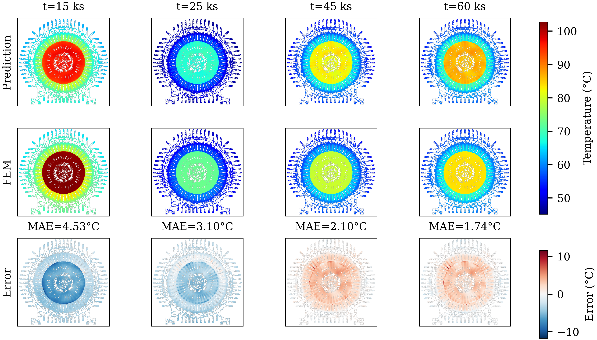
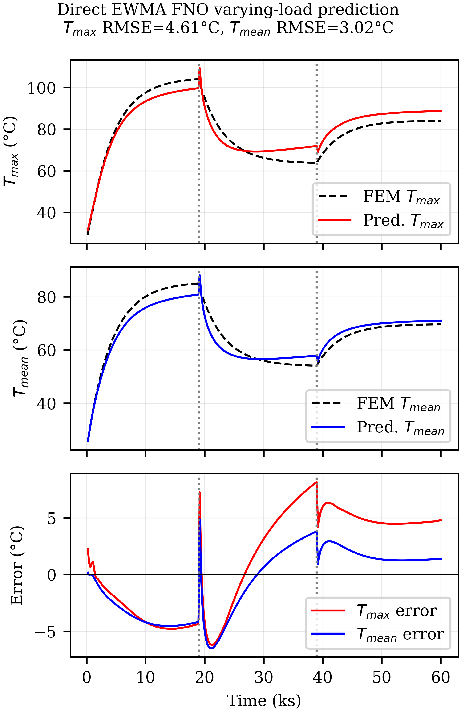
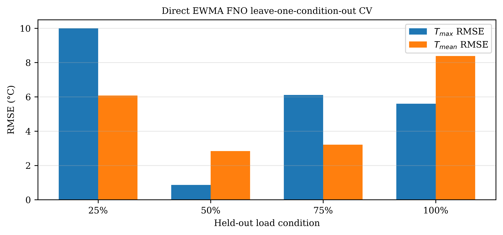

# Motor Thermal Prediction with Fourier Neural Operators

**A Python and PyTorch research workflow for predicting transient electric-motor temperature fields from finite-element simulation data.**

This project was developed by Jinghao Li during an M.Sc. thesis in Systems, Control and Mechatronics at Chalmers University of Technology, carried out at ABB Corporate Research. It combines a Fourier Neural Operator (FNO) with exponentially weighted moving-average (EWMA) load-history features, covering preprocessing, training, evaluation, and visualization.



## Results

The archived final model was trained on five constant-load conditions: 50%, 62.5%, 75%, 87.5%, and 100%. A separate **100% → 50% → 75%** load sequence was used to evaluate its transient response.

| Metric on the varying-load sequence | Archived result |
| --- | ---: |
| Maximum-temperature RMSE | **4.61 °C** |
| Spatial-mean-temperature RMSE | **3.02 °C** |
| Full-profile inference time | **2.22 s** |
| Evaluated time points | 276 |
| Model parameters | 603,489 |

Values come from the included [metrics](reports/varying_load/metrics.json) and [model configuration](artifacts/pretrained/final_all/config.json). Runtime was measured on an NVIDIA A100 80 GB PCIe after CUDA warm-up, excluding model/data loading, FEM rasterization, metric calculation, plotting, and file export. It is not a measurement of the complete application startup time.



## What the project demonstrates

- Turning ANSYS exports into structured, masked spatial datasets with traceable operating conditions.
- Developing a nine-channel FNO that uses the initial temperature, time, coordinates, heat-source information, current load, and three EWMA memory features.
- Separating training, validation, and held-out conditions, with model-specific target normalization calculated from training samples and active pixels.
- Evaluating spatial fields, temperature summaries, local monitoring points, runtime, and limitations under changing loads.

The implementation predicts each requested time directly. Its output is a temperature rise relative to the initial field. See the [method](docs/method.md) for channel definitions and the EWMA update order.

## Explore the repository

| Location | Contents |
| --- | --- |
| [train/direct_ewma](train/direct_ewma) | Original dataset, training, evaluation, and visualization scripts. |
| [artifacts/pretrained/final_all](artifacts/pretrained/final_all) | A pretrained checkpoint, model configuration, normalization, 100-epoch training history, and runtime record. |
| [reports/varying_load](reports/varying_load) | Saved metrics, monitoring-point results, and load-history features. |
| [reports/cross_validation](reports/cross_validation) | Four held-out-condition results and their configurations and training histories. |
| [docs/figures](docs/figures) | Original temperature fields, response curves, EWMA features, and cross-validation plots. |
| [examples/inspect_results.py](examples/inspect_results.py) | Read the saved results and verify artifact checksums without installing ML dependencies. |
| [tools/check_dataset.py](tools/check_dataset.py) | Original diagnostic for inspecting the heat-source channel in a local HDF5 dataset. |

## Quick start

Inspect the published results using Python's standard library:

```sh
python examples/inspect_results.py
```

This command verifies the included artifacts and prints the model configuration, varying-load metrics, and cross-validation table. It reads saved experiments; it does not rerun inference.

For the ML workflow, use Python 3.11 and a dedicated environment:

```sh
python -m venv .venv
```

Activate it on Windows with `.venv\Scripts\Activate.ps1`, or on Linux/macOS with `source .venv/bin/activate`, then install:

```sh
python -m pip install -r requirements.txt
```

A portable [Conda environment](environment.yml) is also included. Core dependency versions are drawn from the original environment; CUDA-specific packages and local build paths have been removed. The reduced environment has not been validated by a complete clean installation.

For full training and inference commands, see [reproducing the experiments](docs/reproducing_experiments.md).

## Cross-validation and limitations

The included leave-one-condition-out results cover 25%, 50%, 75%, and 100% load. These are separate experiments from the final varying-load model. The archived fold metrics explicitly identify `final_model.pth` as the evaluated checkpoint; they should not be described as results from validation-selected `best_model.pth` checkpoints.



Accuracy varies by held-out load. The model also shows transient errors around load changes, as visible in the response plots. These experiments do not establish generalization to different motor geometries, arbitrary load histories, or deployment in a safety-critical control system.

## Data and artifact availability

The pretrained model and selected original experiment outputs are included. Full FEM exports and the processed HDF5 dataset total approximately 4.9 GB locally and are not included in this Git repository. Full numerical reproduction requires the matching data and preprocessing configuration.

The archived varying-load result records `heat_source_mode=base` and `ewma_alignment=previous`. The dataset builder also supports `scaled` heat-source inputs, which have different semantics. Check the configuration before pairing data with a checkpoint; changing input semantics requires retraining.

[artifacts/provenance.json](artifacts/provenance.json) records the original relative paths and SHA-256 hashes of the copied model, figures, and result files. These artifacts are preserved byte for byte.

## Author

**Jinghao Li** — [GitHub](https://github.com/JinghaoLi-Jason) · [LinkedIn](https://www.linkedin.com/in/jinghao-li-669b42315/)
