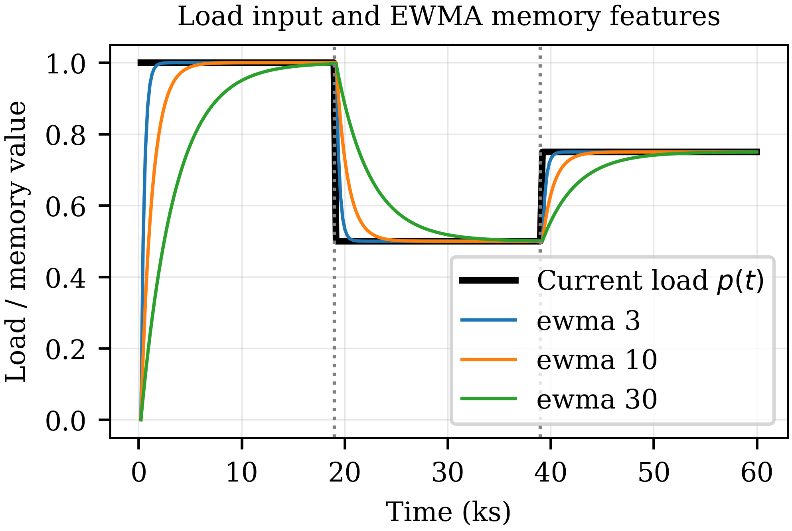
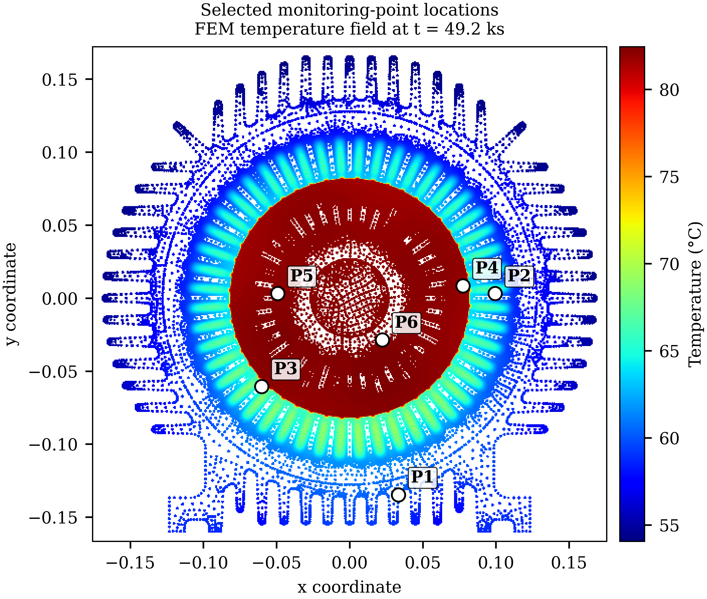
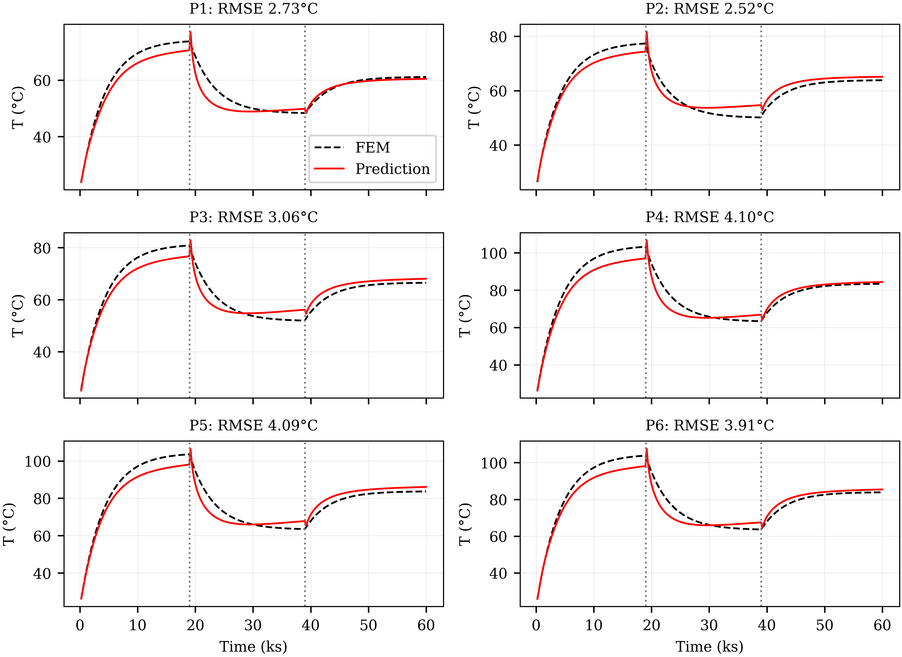

# Direct FNO with load history

## Prediction task

The model maps a spatial description of the motor, an initial temperature field, elapsed time, and a load representation to the temperature rise at a requested time. Absolute temperature is reconstructed by adding the initial field to the predicted rise.

The FNO predicts a complete spatial field in one forward pass. Each requested time is evaluated directly, rather than feeding the previous predicted temperature field back into the next prediction.

## Inputs and output

| Channel | Meaning |
| --- | --- |
| 0 | Normalized initial temperature field. |
| 1 | Normalized elapsed time. |
| 2–3 | Spatial coordinates. |
| 4 | Heat-source input field. Its meaning depends on `heat_source_mode`. |
| 5 | Current load fraction. |
| 6–8 | EWMA load-history features with spans 3, 10, and 30. |

The output has one channel: normalized temperature rise. Model-specific mean and standard deviation convert it back into degrees Celsius. A geometry mask identifies active motor pixels for training losses and temperature summaries.

## EWMA update order

For a span `s`, the smoothing coefficient is `alpha = 2 / (s + 1)`. Each memory starts at zero.

With `ewma_alignment=previous`, the stored memory contains preceding loads. The prediction for sample `i` uses the current load separately, then updates each memory:

```text
predict using current load p[i] and stored memory m[i]
m[i + 1] = alpha * p[i] + (1 - alpha) * m[i]
```

The first supplied memory values are zero. Changing the update order changes the input representation and requires a compatible training run.



## Heat-source configuration

`base` supplies a fixed reference heat-source field, with current load represented by its own channel. `scaled` supplies the load-scaled heat-source field. The raw-data builder supports both; its default is `scaled`, while the archived final varying-load evaluation records `base`.

The inference implementation takes its spatial reference channels from the supplied HDF5 dataset. Consequently, a checkpoint alone is insufficient for reproducing its spatial predictions: the corresponding input fields and preprocessing metadata are also needed.

## Normalization and evaluation

The HDF5 format retains global statistics for storage compatibility. During training, physical target values are reconstructed and target statistics are calculated from training samples and active geometry pixels. Those model-specific statistics are then reused for validation, testing, and inference.

For leave-one-condition-out evaluation, one load condition is held out. The `loco_val` workflow additionally separates validation samples for model selection. The published historical fold metrics identify which checkpoint was actually evaluated.

The separate varying-load evaluation compares global maximum and spatial-mean temperatures, selected local monitoring points, and representative temperature fields. Runtime is recorded with its scope and hardware.




